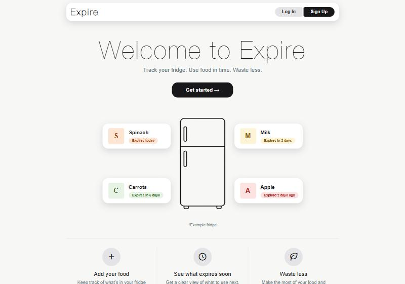

# Expire

Expire is a web app I built to keep track of the food in my fridge. You add your food and when it expires, and Expire shows you what needs eating soon, so less of it ends up in the bin.

## What it does

- Shows your food in a fridge with a freezer at the top, and you can drag food between spots
- Colors each food by how fresh it is, from green (fresh) to red (expired)
- Lets you mark food as eaten or thrown out, and keeps count on your profile
- Has accounts, so everyone gets their own fridge

## Built with

Angular for the frontend, ASP.NET Core (.NET 10) for the backend, and a PostgreSQL database.
